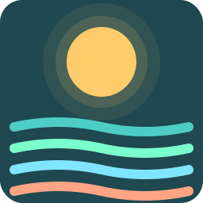
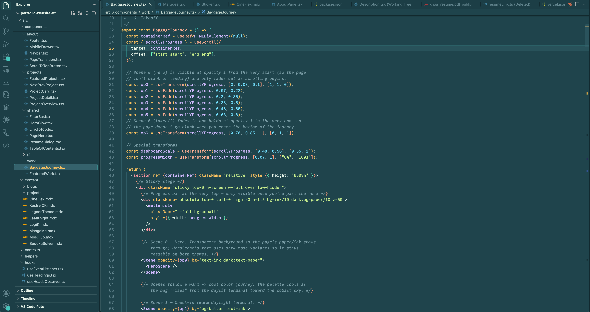
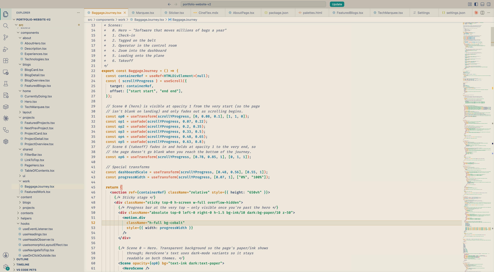
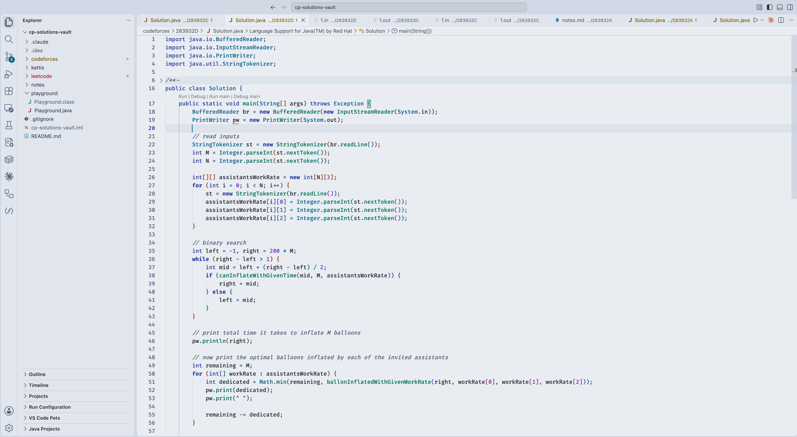

  

<h1 align="center">Lagoon Theme</h1>

Hi there! 🌊
I made Lagoon in five variants so you can pick whichever fits your day. **Lagoon Night** feels like quiet evenings by warm tropical water — gold keywords, coral functions, lime strings and lavender types drifting across atmospheric teal. **Lagoon Depths** takes the same palette out past the reef, into deeper ocean blue. **Lagoon Dusk** is the water just after sunset, under a soft indigo sky. **Lagoon Shore** keeps the warm palette on cream paper, for brighter desks. **Lagoon Tide** is the cool, crisp side of the water — snow-white backgrounds with indigo keywords, sea-green functions, ocean-blue types and warm terracotta strings. Hope you like it ^^

### Installation

- Open the Extensions panel in VS Code
- Search for **Lagoon Theme** and click Install
- Open the Color Theme picker and choose **Lagoon Night**, **Lagoon Depths**, **Lagoon Dusk**, **Lagoon Shore** or **Lagoon Tide**

### Screenshots

**Lagoon Night**

**Lagoon Shore**

**Lagoon Tide**

### Feedback
Lagoon is continuously being updated. If a color feels off, a token needs better separation, or you'd like to see a tweak — please [open an issue on GitHub](https://github.com/DNT-Khoa/lagoon-theme/issues). Suggestions are very welcome.

Repo: [github.com/DNT-Khoa/lagoon-theme](https://github.com/DNT-Khoa/lagoon-theme)

### Releases
See the [GitHub Releases page](https://github.com/DNT-Khoa/lagoon-theme/releases) for version history and per-release changelogs.
